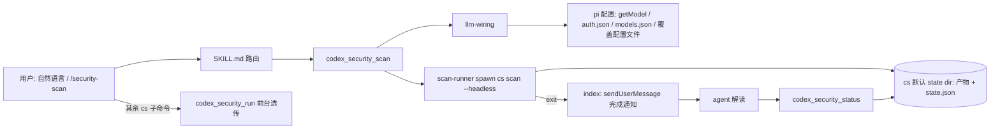

# pi-codex-security 包设计文档

> 日期:2026-10-16 | 状态:已批准(门 1,2026-10-16)
> 流程:dev 重流程阶段 1 产出;配套实现规格 ./spec.md(骨架随本文件一同过门 1)
>
> 本文件是决策快照:门 1 批准后冻结,开发期不改。实现期发现的设计偏差记入 spec.md 变更记录;推翻本文决策时走回退协议(ADR 取代或精确回退),不就地修改。

## 背景与问题

用户在 pi 会话中无法便捷使用已安装的 codex-security CLI(cs 0.3.0):

- cs 是独立 CLI,扫描需手工拼接命令、解决 LLM 凭证与协议接线,并处理「扫描动辄数分钟」的等待问题。
- 扫描产物(findings.json / report.md)是机器格式,缺少按严重级别的可读解读。
- 部分子命令会改代码(patch)或写外部系统(publish / --create-pr),缺统一的执行纪律。

pi 侧已有完整基建:扩展可注册工具与命令,skill 可路由自然语言,pi 配置的第三方 LLM 服务(GLM Coding Plan 等)可被复用为扫描引擎的推理后端。

## 目标与非目标

- **目标**:
  - 任一 git 项目中,一句自然语言或 `/security-scan` 即可发起扫描,后台执行、完成后自动推送结果并解读。
  - 扫描引擎的 LLM 自动接线:跟随会话模型(`/model` 切换即生效),凭证自动取自 pi 配置,零手工配置。
  - cs CLI 全部子命令可经本包调用;危险操作有明确执行纪律。
  - 以 pi 包形态交付,`pi install` 即装。
- **非目标**(一行一个):
  - 不包装 `cs login` / `cs logout`:扫描凭证走 pi 路线,永远不需要 ChatGPT 登录;用户终端自跑不受限。
  - 不内置官方 21 个手册 skill 的副本:经 run 透传 `cs skills add` 可一键同步,场景超出本包指引时 agent 主动提醒。
  - 不做 CI 集成、不做 MCP 通道(官方 `scanMcp: false` 已排除扫描走 MCP)。
  - 不二次加工 `policy` / `validate` / `dedupe` 等命令的语义: faithfully 透传 + 输出可读化,全覆盖指「全部可用」,不是「逐命令定制 UI」。

## 方案概述

一个 pi 包(约定目录 `extensions/` + `skills/`),扩展注册两个专项工具与一个通用执行器:`codex_security_scan`(后台 spawn cs scan,立即返回句柄)、`codex_security_status`(查进度、解析产物为严重级别摘要)、`codex_security_run`(透传其余全部 cs 子命令,前台执行、输出截断、超时控制)。扫描完成经 `sendUserMessage` 推送 agent 触发解读轮。LLM 接线由扩展在运行时完成:读取会话当前模型(pi.getModel),按协议直连或经内置端点映射转为智谱 Responses 端点,凭证从 pi 配置读出后经环境变量注入子进程,不进命令行、不落盘。

放弃的备选方案:

- 逐命令包工具(20+ 工具):工具面爆炸,维护成本高,已由「专项 + 透传」架构取代(ADR-0002)。
- 扫描固定单一模型:丢失 /model 切换的计费与质量选择权,用户明确要求跟随会话(ADR-0001)。
- 不兼容协议时自动回退默认模型:会在用户不知情时用别的模型计费,改为配置文件显式覆盖 + 报错(ADR-0001)。
- 同步阻塞等待扫描完成:会话冻结数十分钟,不可接受。
- MCP 通道:官方硬约束排除(`scanMcp: false`)。

### 模块划分鸟瞰

```text
pi-codex-security/                  ← 包根(pi install 目标)
├── package.json                    ← pi 包声明(peerDependencies 指向宿主包)
├── extensions/
│   ├── index.ts                    ← 入口:注册 3 工具 + 1 命令 + 完成通知
│   ├── llm-wiring.ts               ← 会话模型 → cs provider 注入参数与环境变量
│   ├── scan-runner.ts              ← 扫描进程生命周期:spawn/注册表/pid 落盘/状态查询
│   └── findings-parser.ts          ← 扫描产物 → 严重级别摘要(findings.json 优先,report.md 降级)
└── skills/
    └── codex-security-scan/
        └── SKILL.md                ← 触发路由 + 全命令参考 + 分级安全纪律
```

- `index.ts`:装配层,工具与命令的薄封装,行为契约在 spec.md「pi 工具」节。
- `llm-wiring.ts`:唯一知道 pi 配置文件格式与协议映射表的模块;输出 cs 的 `--codex` TOML 参数串与子进程环境变量。
- `scan-runner.ts`:唯一触碰进程与文件系统的扫描执行模块;会话重启后凭落盘 state.json 恢复查询,不依赖内存。
- `findings-parser.ts`:唯一解析扫描产物的模块;解析失败降级返回报告路径,不报假状态。
- `SKILL.md`:纯文档,定义自然语言路由、全部子命令用法参考、三级执行纪律。



## 技术栈与依赖约束

- TypeScript,由 pi 的 jiti 直接运行,不设编译步骤、不设 build 脚本。
- 零第三方 npm 依赖:进程用 `node:child_process`,文件用 `node:fs`,schema 用宿主提供的 `typebox`。
- peerDependencies 声明宿主包(`@earendil-works/pi-coding-agent`、`typebox`),range `"*"`,不进 dependencies、不打包。
- 外部运行时依赖:cs CLI ≥ 0.3.0 在 PATH;缺失时工具返回可读错误,不尝试安装。
- 目标平台:Windows / macOS / Linux(pi 本身跨平台);路径拼接一律 `node:path`,不手拼分隔符。
- 密钥红线:API key 只存在于进程环境变量传递链,禁止出现在命令行参数、日志、落盘文件、错误消息。
- 扫描产物统一用 cs 默认 state dir(官方强制仓库外),本包不重定向 `--output-dir`。

## 权衡

- 扫描引擎 LLM 跟随会话模型 + 配置文件覆盖 + 显式报错:见 [ADR-0001](../../docs/adr/0001-scan-engine-follows-session-model.md)。
- 「专项工具精包装 + 通用执行器透传」的全覆盖架构:见 [ADR-0002](../../docs/adr/0002-specialized-tools-plus-passthrough.md)。
- 凭证自动读 pi 配置(auth.json / models.json):零配置是用户明确要求;代价是依赖 pi 内部文件格式,升级可能变化——`llm-wiring` 读不到 key 时降级为读环境变量 `ZAI_API_KEY`,再读不到报可读错误。该依赖风险被隔离在 `llm-wiring.ts` 单模块内。
- 后台 + 完成通知(而非同步):扫描时长不可控(分钟级到小时级);`detached` 进程脱离 pi 会话存活,重启后凭 state.json 恢复查询。代价是通知依赖 pi 会话存活,跨会话完成只能靠用户主动 `status` 查询——skill 已写明该边界。
- 产物用 cs 默认 state dir(而非仓库内 .tmp):官方 `--output-dir` 明确要求仓库外,默认值零成本合规;报告路径由 status 工具返回,用户不需要自己找。
- 并发扫描上限定为 2:扫描是重任务,叠加会撑爆积分与机器;2 允许「分支 + 工作树」并行对比场景。机检方案见 spec.md 数值预算节。

## 开放问题

无。design tree 所有分支已在访谈中收敛,无默默假设。
