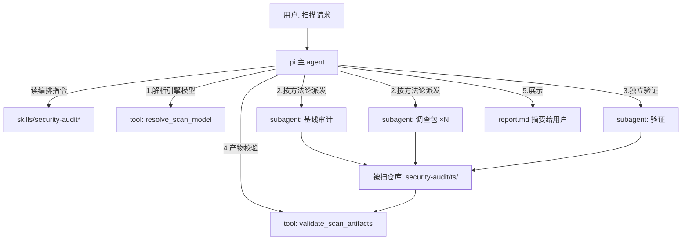

# pi-security-audit 设计文档

> 日期:2026-10-19 | 状态:草稿(门 1 批准后改为:已批准)
> 流程:dev 重流程阶段 1 产出;配套实现规格 ./spec.md(骨架随本文件一同过门 1)
>
> 本文件是决策快照:门 1 批准后冻结,开发期不改。实现期发现的设计偏差记入 spec.md 变更记录;推翻本文决策时走回退协议(ADR 取代或精确回退),不就地修改。

## 背景与问题

- pi-codex-security 现有实现把扫描能力建立在 cs(`@openai/codex-security`)之上,而 cs 把 agent 循环与 LLM 通信全部委托给 codex 引擎。
- 两天真实使用暴露 4 类环境故障:web_search 被第三方网关拒、Windows 沙箱 DLL 锁、沙箱账户 1909、credential home ACL。
- 根因:环境敏感度集中在链条最脆弱的一环(codex 引擎的本机状态),修复权不在本包手里。
- cs 真正的核心资产是**审计方法论提示词与产物契约**(Apache 2.0,约 8000 行),它引擎无关——资产可以留下,引擎可以换掉。
- 结论:cs/codex 接线路线被证伪,本仓库推倒重来,扫描能力改跑在 pi 自己的 subagent 循环上。

## 目标与非目标

- **目标**:
  - 无 codex/cs 依赖的 pi 原生安全审计插件,`pi install` 即用。
  - paths 全库扫描 + diff 扫描两种模式,产出符合契约的 findings.json / coverage.json / report.md。
  - 独立验证纪律(发现须经反证检验才入报告)复现 cs 的反误报能力。
  - 引擎模型:配置优先,无配置回退会话模型。
- **非目标**:
  - deep 扫描模式(cs 官方标注成本不可控,上限 96h)。
  - patch / remediation / verify-fix(修复类能力)。
  - GitHub / Jira / triage / threat-model 独立 skill(cs 其余 14 个 skill)。
  - 保留任何旧 cs/codex 接线代码。

## 方案概述

采用 **Skill 驱动**架构:编排逻辑(威胁建模 → 派调查包 → 独立验证 → 报告)全部写在改写后的方法论 skills 提示词里,由 pi 主 agent 按方法论自主派发 subagent 执行;插件代码只提供两个薄工具(引擎模型解析、产物契约校验)与从 cs 复制来的 schemas。放弃的备选:

- SDK 编排(插件代码写死流水线):可控但僵化,代码量大,agent 自主性低——skill 驱动下 pi 的规划能力足以承载编排。
- 保留 cs 引擎只重构代码:环境问题根因不变,重构无意义(用户已证伪该路线)。

### 模块划分鸟瞰

- `skills/security-audit/` — 主方法论 skill(改写自 cs 的 security-scan + core-scan),paths 模式编排指令。
- `skills/security-audit-diff/` — diff 模式变体 skill(改写自 cs 的 security-diff-scan)。
- `skills/security-audit-shared/` — 两模式共享的 references(验证纪律、产物契约、报告格式,改写自 cs 同名文档)。
- `extensions/index.ts` — 插件入口:注册两个薄工具。
- `extensions/scan-model.ts` — 引擎模型解析(配置优先 → 会话回退 → 显式报错)。
- `extensions/artifact-validator.ts` — 产物契约校验(轻量 JSON Schema 子集校验器)。
- `schemas/` — 从 cs 原样复制的 JSON Schema(findings/coverage/scan-manifest,保留 Apache 2.0 版权标注)。
- `.gitignore` — 新增 `.security-audit/`(产物目录)。

### 架构图

## 技术栈与依赖约束

- TypeScript 由 pi 的 jiti 直跑:不设编译、不设 build 脚本(延续既有工程边界)。
- **零第三方 npm 依赖**:schema 校验自写轻量子集(见 spec 编码方向),不引 ajv。
- 运行前提:pi 环境具备 subagent 能力(pi-subagents)——skill 文档开头声明,缺失时 agent 按降级路径(会话内串行审计)执行并在报告标注。
- 测试:node:test 内置框架,`node --experimental-strip-types --test extensions/*.test.ts`。
- 平台:Windows 优先(用户环境),不依赖任何 Unix-only 工具。
- 产物目录 `.security-audit/` 必须进 .gitignore(交付物之一)。

## 权衡

- **引擎模型优先级反转**(配置 > 会话):与旧 ADR-0001 相反。理由:扫描需要稳定、可预算的引擎模型,会话模型是日常对话用的、频繁切换;两者解耦后互不干扰。→ 落地为新 ADR-0003。
- **Skill 驱动的代价**:编排一致性靠提示词纪律而非代码保障,多 subagent 长任务有跑偏风险。接受理由:cs 方法论本身「就是写给 agent 的指令」,pi 的 subagent 并行/异步能力天然匹配;换取零引擎依赖与最小代码面。→ 落地为新 ADR-0004。
- **产物放仓库内**(与 cs/旧插件相反):用户偏好「就近可查」优先;配套 .gitignore 消除污染。→ 已在访谈确认,随 ADR-0004 一并记录。
- **轻量 schema 校验器而非 ajv**:零依赖纪律;我们只校验自己两份已知 schema,所需子集(required/type/enum/items/properties/$ref 内部引用)手写约百行。
- **知识层忠实改写而非精简重写**:cs 方法论是多轮实战打磨的资产,压缩会丢质量;仅替换运行时 API 调用点(映射表见 spec 编码方向)。

## 开放问题

无。
